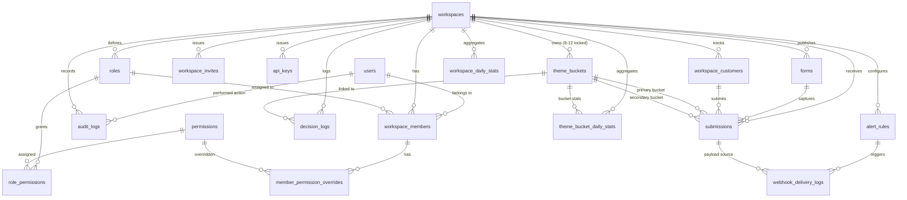

# Master Database Schema Specification: Voice of Customer (VoC) Platform (V1)

> **Document Status:** Final Architecture Spec  
> **Target Database Engine:** PostgreSQL 16+ (with `uuid-ossp` or native `gen_random_uuid()` and `pgcrypto`)  
> **ORM / Migration Framework:** SQLAlchemy 2.0 (Async) + Alembic  
> **Key Architectural Tenets:** Multi-tenant isolation, Dynamic RBAC with Member Overrides, Longitudinal Customer Profiles, Soft Deletion for Analytics Preservation, Zero Hardcoded Assumptions.

---

## 1. Executive Summary & Design Principles

1. **Multi-Tenant Security:** Every tenant entity carries a `workspace_id` foreign key. Compound indexes lead with `workspace_id` to guarantee fast, partition-like scoping.
2. **Point-in-Time Integrity:** `submissions` stores snapshot attributes (`developer_attributes`, `customer_tier_snapshot`, `customer_spend_snapshot`) so historical metrics are never corrupted if a customer upgrades or changes attributes months later.
3. **Non-Destructive Soft Deletes (`deleted_at`):** Core business assets (`workspaces`, `forms`, `theme_buckets`, `workspace_customers`, `decision_logs`) are soft-deleted. Foreign keys from `submissions` use `ON DELETE RESTRICT` so accidental scripts cannot wipe out feedback history.
4. **PostgreSQL Partial Unique Indexes:** Partial indexes (`WHERE deleted_at IS NULL`) ensure uniqueness across active records without colliding on PostgreSQL `NULL != NULL` behavior. Case-insensitivity (`LOWER(name)`, `LOWER(slug)`, `LOWER(email)`) is enforced at the database index level.
5. **Score Driver Optimization:** Rollup tables (`theme_bucket_daily_stats` and `workspace_daily_stats`) maintain pre-aggregated counts, sums, and `rated_submissions_count` for sub-millisecond calculation of Net Score Impact:
   $$\text{Net Score Impact}_B = \frac{N_{B, \text{rated}}}{N_{\text{workspace, rated}}} \times (\bar{S}_B - \bar{S}_{\text{workspace}})$$

---

## 2. Complete Entity-Relationship Model



---

## 3. Table Schemas, Columns & Constraints

---

### Group A: Authentication, Tenancy & API Access

#### 1. `users`
Global user identity across the platform.

```sql
CREATE TABLE users (
    id UUID PRIMARY KEY DEFAULT gen_random_uuid(),
    email VARCHAR(255) NOT NULL,
    password VARCHAR(255) NOT NULL,
    full_name VARCHAR(255) NULL,
    avatar_url TEXT NULL,
    is_active BOOLEAN NOT NULL DEFAULT TRUE,
    is_verified BOOLEAN NOT NULL DEFAULT FALSE,
    created_at TIMESTAMPTZ NOT NULL DEFAULT NOW(),
    updated_at TIMESTAMPTZ NOT NULL DEFAULT NOW(),
    deleted_at TIMESTAMPTZ NULL
);

CREATE UNIQUE INDEX idx_users_email_active ON users(LOWER(email)) WHERE deleted_at IS NULL;
```

#### 2. `workspaces`
Tenant boundary. No forced default industry or business type—completely user-driven.

```sql
CREATE TABLE workspaces (
    id UUID PRIMARY KEY DEFAULT gen_random_uuid(),
    name VARCHAR(255) NOT NULL,
    slug VARCHAR(255) NOT NULL,
    logo_url TEXT NULL,
    industry VARCHAR(50) NULL,
    business_type VARCHAR(50) NULL,
    timezone VARCHAR(50) NOT NULL DEFAULT 'UTC',
    plan_tier VARCHAR(50) NOT NULL DEFAULT 'free',
    monthly_submission_limit INTEGER NOT NULL DEFAULT 500,
    current_cycle_submissions_count INTEGER NOT NULL DEFAULT 0,
    cycle_reset_at TIMESTAMPTZ NOT NULL DEFAULT NOW(),
    ai_classification_enabled BOOLEAN NOT NULL DEFAULT TRUE,
    created_at TIMESTAMPTZ NOT NULL DEFAULT NOW(),
    updated_at TIMESTAMPTZ NOT NULL DEFAULT NOW(),
    deleted_at TIMESTAMPTZ NULL
);

CREATE UNIQUE INDEX idx_workspaces_slug_active ON workspaces(LOWER(slug)) WHERE deleted_at IS NULL;
```

#### 3. `api_keys`
API tokens for headless form ingestion, mobile apps, and custom server integrations.

```sql
CREATE TABLE api_keys (
    id UUID PRIMARY KEY DEFAULT gen_random_uuid(),
    workspace_id UUID NOT NULL REFERENCES workspaces(id) ON DELETE CASCADE,
    name VARCHAR(100) NOT NULL,
    key_prefix VARCHAR(16) NOT NULL,
    key_hash VARCHAR(255) NOT NULL,
    scopes JSONB NOT NULL DEFAULT '["submissions:write"]'::jsonb,
    last_used_at TIMESTAMPTZ NULL,
    expires_at TIMESTAMPTZ NULL,
    created_by_user_id UUID NULL REFERENCES users(id) ON DELETE SET NULL,
    created_at TIMESTAMPTZ NOT NULL DEFAULT NOW(),
    revoked_at TIMESTAMPTZ NULL
);

CREATE INDEX idx_api_keys_ws ON api_keys(workspace_id) WHERE revoked_at IS NULL;
CREATE INDEX idx_api_keys_prefix ON api_keys(key_prefix) WHERE revoked_at IS NULL;
```

---

### Group B: Dynamic RBAC, Invites & Audit Logging

#### 4. `permissions`
Master catalog of granular application permissions.

```sql
CREATE TABLE permissions (
    id VARCHAR(100) PRIMARY KEY, -- e.g. "forms:create", "submissions:triage"
    name VARCHAR(255) NOT NULL,
    description TEXT NOT NULL,
    category VARCHAR(50) NOT NULL, -- "workspace", "forms", "submissions", "taxonomy", "analytics", "billing"
    created_at TIMESTAMPTZ NOT NULL DEFAULT NOW()
);
```

#### 5. `roles`
Workspace-scoped roles. Seeded with defaults (`owner`, `admin`, `editor`, `viewer`), but custom roles can be created.

```sql
CREATE TABLE roles (
    id UUID PRIMARY KEY DEFAULT gen_random_uuid(),
    workspace_id UUID NOT NULL REFERENCES workspaces(id) ON DELETE CASCADE,
    name VARCHAR(100) NOT NULL,
    slug VARCHAR(100) NOT NULL,
    description TEXT NULL,
    is_system BOOLEAN NOT NULL DEFAULT FALSE, -- True for Owner (protected)
    created_at TIMESTAMPTZ NOT NULL DEFAULT NOW(),
    updated_at TIMESTAMPTZ NOT NULL DEFAULT NOW()
);

CREATE UNIQUE INDEX idx_roles_ws_slug ON roles(workspace_id, LOWER(slug));
```

#### 6. `role_permissions`
Assigns permissions to roles. Allows increasing or decreasing role capabilities.

```sql
CREATE TABLE role_permissions (
    id UUID PRIMARY KEY DEFAULT gen_random_uuid(),
    role_id UUID NOT NULL REFERENCES roles(id) ON DELETE CASCADE,
    permission_id VARCHAR(100) NOT NULL REFERENCES permissions(id) ON DELETE CASCADE,
    created_at TIMESTAMPTZ NOT NULL DEFAULT NOW(),
    CONSTRAINT uq_role_permission UNIQUE (role_id, permission_id)
);

CREATE INDEX idx_role_permissions_role ON role_permissions(role_id);
```

#### 7. `workspace_members`
Links users to workspaces with a primary role.

```sql
CREATE TABLE workspace_members (
    id UUID PRIMARY KEY DEFAULT gen_random_uuid(),
    workspace_id UUID NOT NULL REFERENCES workspaces(id) ON DELETE CASCADE,
    user_id UUID NOT NULL REFERENCES users(id) ON DELETE CASCADE,
    role_id UUID NOT NULL REFERENCES roles(id) ON DELETE RESTRICT,
    created_at TIMESTAMPTZ NOT NULL DEFAULT NOW(),
    updated_at TIMESTAMPTZ NOT NULL DEFAULT NOW(),
    CONSTRAINT uq_workspace_member UNIQUE (workspace_id, user_id)
);

CREATE INDEX idx_workspace_members_ws_user ON workspace_members(workspace_id, user_id);
CREATE INDEX idx_workspace_members_user ON workspace_members(user_id);
```

#### 8. `member_permission_overrides`
User-level permission adjustments. Enables granting (`+`) or revoking (`-`) individual permissions without altering the shared role.

```sql
CREATE TABLE member_permission_overrides (
    id UUID PRIMARY KEY DEFAULT gen_random_uuid(),
    workspace_member_id UUID NOT NULL REFERENCES workspace_members(id) ON DELETE CASCADE,
    permission_id VARCHAR(100) NOT NULL REFERENCES permissions(id) ON DELETE CASCADE,
    is_granted BOOLEAN NOT NULL, -- TRUE: explicit grant; FALSE: explicit revoke
    created_at TIMESTAMPTZ NOT NULL DEFAULT NOW(),
    CONSTRAINT uq_member_override UNIQUE (workspace_member_id, permission_id)
);

CREATE INDEX idx_member_overrides_member ON member_permission_overrides(workspace_member_id);
```

#### 9. `workspace_invites`
Team invitation tokens with expiration and role assignment.

```sql
CREATE TABLE workspace_invites (
    id UUID PRIMARY KEY DEFAULT gen_random_uuid(),
    workspace_id UUID NOT NULL REFERENCES workspaces(id) ON DELETE CASCADE,
    email VARCHAR(255) NOT NULL,
    role_id UUID NOT NULL REFERENCES roles(id) ON DELETE CASCADE,
    token_hash VARCHAR(255) NOT NULL UNIQUE,
    status VARCHAR(30) NOT NULL DEFAULT 'pending', -- pending, accepted, revoked, expired
    invited_by_user_id UUID NULL REFERENCES users(id) ON DELETE SET NULL,
    expires_at TIMESTAMPTZ NOT NULL,
    created_at TIMESTAMPTZ NOT NULL DEFAULT NOW()
);

CREATE INDEX idx_workspace_invites_ws_email ON workspace_invites(workspace_id, LOWER(email));
```

#### 10. `audit_logs`
Enterprise-grade activity trail tracking all sensitive operations.

```sql
CREATE TABLE audit_logs (
    id UUID PRIMARY KEY DEFAULT gen_random_uuid(),
    workspace_id UUID NOT NULL REFERENCES workspaces(id) ON DELETE CASCADE,
    actor_user_id UUID NULL REFERENCES users(id) ON DELETE SET NULL,
    action VARCHAR(100) NOT NULL,
    resource_type VARCHAR(50) NOT NULL,
    resource_id VARCHAR(255) NOT NULL,
    ip_address VARCHAR(45) NULL,
    user_agent TEXT NULL,
    changes JSONB NOT NULL DEFAULT '{}'::jsonb,
    created_at TIMESTAMPTZ NOT NULL DEFAULT NOW()
);

CREATE INDEX idx_audit_logs_ws_date ON audit_logs(workspace_id, created_at DESC);
CREATE INDEX idx_audit_logs_actor ON audit_logs(actor_user_id);
```

---

### Group C: Customer Profiles & Omnichannel Forms

#### 11. `workspace_customers`
First-class longitudinal customer profile (Canny / Delighted style).

```sql
CREATE TABLE workspace_customers (
    id UUID PRIMARY KEY DEFAULT gen_random_uuid(),
    workspace_id UUID NOT NULL REFERENCES workspaces(id) ON DELETE CASCADE,
    external_user_id VARCHAR(255) NULL,
    email VARCHAR(255) NULL,
    name VARCHAR(255) NULL,
    avatar_url TEXT NULL,
    company_name VARCHAR(255) NULL,
    company_domain VARCHAR(255) NULL,
    tier VARCHAR(50) NULL,
    monthly_spend NUMERIC(10, 2) NULL,
    lifetime_submissions_count INTEGER NOT NULL DEFAULT 0,
    avg_normalized_score NUMERIC(5, 2) NULL,
    custom_attributes JSONB NOT NULL DEFAULT '{}'::jsonb,
    first_seen_at TIMESTAMPTZ NOT NULL DEFAULT NOW(),
    last_seen_at TIMESTAMPTZ NOT NULL DEFAULT NOW(),
    created_at TIMESTAMPTZ NOT NULL DEFAULT NOW(),
    updated_at TIMESTAMPTZ NOT NULL DEFAULT NOW(),
    deleted_at TIMESTAMPTZ NULL
);

-- Fix 5: Case-insensitive partial indexes on email and external_id
CREATE UNIQUE INDEX idx_cust_ws_external_id ON workspace_customers(workspace_id, external_user_id) 
WHERE external_user_id IS NOT NULL AND deleted_at IS NULL;

CREATE UNIQUE INDEX idx_cust_ws_email ON workspace_customers(workspace_id, LOWER(email)) 
WHERE email IS NOT NULL AND deleted_at IS NULL;

CREATE INDEX idx_cust_ws_search ON workspace_customers(workspace_id, last_seen_at DESC) 
WHERE deleted_at IS NULL;
```

#### 12. `forms`
Form Studio & Widget configurations. 

```sql
CREATE TABLE forms (
    id UUID PRIMARY KEY DEFAULT gen_random_uuid(),
    workspace_id UUID NOT NULL REFERENCES workspaces(id) ON DELETE CASCADE,
    name VARCHAR(255) NOT NULL,
    slug VARCHAR(100) NOT NULL,
    is_active BOOLEAN NOT NULL DEFAULT TRUE,
    template_type VARCHAR(50) NULL,
    title VARCHAR(255) NOT NULL,
    subtitle TEXT NULL,
    rating_scale_type VARCHAR(30) NOT NULL DEFAULT '5_star', -- 5_star, 5_emoji, 1_10_numeric
    rating_required BOOLEAN NOT NULL DEFAULT TRUE, -- Fix 3: Rating can be optional
    category_pills JSONB NOT NULL DEFAULT '[]'::jsonb,
    custom_questions JSONB NOT NULL DEFAULT '[]'::jsonb,
    open_feedback_prompt VARCHAR(255) NOT NULL,
    open_feedback_placeholder TEXT NULL,
    contact_field_mode VARCHAR(20) NOT NULL DEFAULT 'optional', -- hidden, optional, required
    theme_config JSONB NOT NULL DEFAULT '{}'::jsonb,
    outcome_screen JSONB NOT NULL DEFAULT '{}'::jsonb,
    widget_settings JSONB NOT NULL DEFAULT '{}'::jsonb,
    allowed_domains JSONB NOT NULL DEFAULT '[]'::jsonb,
    created_at TIMESTAMPTZ NOT NULL DEFAULT NOW(),
    updated_at TIMESTAMPTZ NOT NULL DEFAULT NOW(),
    deleted_at TIMESTAMPTZ NULL
);

-- Fix 4: Workspace-scoped unique form slug
CREATE UNIQUE INDEX idx_forms_ws_slug_active ON forms(workspace_id, LOWER(slug)) 
WHERE deleted_at IS NULL;

CREATE INDEX idx_forms_ws_active ON forms(workspace_id) 
WHERE deleted_at IS NULL;
```

---

### Group D: Submissions & The Core Signal Trio

#### 13. `submissions`
Normalized submission record with point-in-time snapshot preservation.

```sql
CREATE TABLE submissions (
    id UUID PRIMARY KEY DEFAULT gen_random_uuid(),
    workspace_id UUID NOT NULL REFERENCES workspaces(id) ON DELETE CASCADE,
    form_id UUID NOT NULL REFERENCES forms(id) ON DELETE RESTRICT, -- Fix 6: Protect submissions from form hard-delete
    customer_id UUID NULL REFERENCES workspace_customers(id) ON DELETE SET NULL,
    status VARCHAR(30) NOT NULL DEFAULT 'new', -- new, in_review, resolved, spam, archived
    
    -- Fix 3: Scores are NULLABLE to support optional rating forms
    raw_score NUMERIC(4, 1) NULL,
    rating_scale_type VARCHAR(30) NULL,
    normalized_score NUMERIC(5, 2) NULL,
    
    -- Signal 2: Structured Context & User Answers
    selected_pill_id VARCHAR(100) NULL,
    selected_pill_label VARCHAR(100) NULL,
    custom_answers JSONB NOT NULL DEFAULT '{}'::jsonb,
    source VARCHAR(30) NOT NULL DEFAULT 'widget', -- widget, hosted_page, qr_code, csv_import, manual
    page_url TEXT NULL,
    page_title TEXT NULL,
    referrer TEXT NULL,
    url_query_params JSONB NOT NULL DEFAULT '{}'::jsonb,
    device_type VARCHAR(30) NULL,
    browser VARCHAR(50) NULL,
    os VARCHAR(50) NULL,
    ip_address_hash VARCHAR(64) NULL,
    
    -- Fix 1: Developer attributes & Point-in-Time snapshot
    developer_attributes JSONB NOT NULL DEFAULT '{}'::jsonb,
    customer_tier_snapshot VARCHAR(50) NULL,
    customer_spend_snapshot NUMERIC(10, 2) NULL,
    
    -- Signal 3: Open Feedback & AI Taxonomy
    open_text TEXT NULL,
    primary_bucket_id UUID NULL REFERENCES theme_buckets(id) ON DELETE SET NULL,
    secondary_bucket_id UUID NULL REFERENCES theme_buckets(id) ON DELETE SET NULL,
    sentiment VARCHAR(20) NOT NULL DEFAULT 'neutral', -- positive, neutral, negative
    sentiment_confidence NUMERIC(3, 2) NULL,
    classification_method VARCHAR(30) NOT NULL DEFAULT 'unclassified', -- pill_match, keyword_rule, llm_classified, manual_override, unclassified
    is_classified BOOLEAN NOT NULL DEFAULT FALSE,
    is_spam BOOLEAN NOT NULL DEFAULT FALSE,
    spam_reason VARCHAR(255) NULL,
    
    -- Triage & Resolution Workflow
    resolved_at TIMESTAMPTZ NULL,
    resolved_by_user_id UUID NULL REFERENCES users(id) ON DELETE SET NULL,
    internal_notes TEXT NULL,
    last_replied_at TIMESTAMPTZ NULL,
    
    created_at TIMESTAMPTZ NOT NULL DEFAULT NOW(),
    updated_at TIMESTAMPTZ NOT NULL DEFAULT NOW(),
    deleted_at TIMESTAMPTZ NULL
);

-- Core performance indexes
CREATE INDEX idx_submissions_ws_status_date ON submissions(workspace_id, status, created_at DESC) 
WHERE deleted_at IS NULL;

CREATE INDEX idx_submissions_ws_bucket_score ON submissions(workspace_id, primary_bucket_id, normalized_score) 
WHERE deleted_at IS NULL;

CREATE INDEX idx_submissions_ws_customer ON submissions(workspace_id, customer_id) 
WHERE deleted_at IS NULL;

CREATE INDEX idx_submissions_ws_tier ON submissions(workspace_id, customer_tier_snapshot) 
WHERE customer_tier_snapshot IS NOT NULL AND deleted_at IS NULL;

-- Fix 1: GIN index matches developer_attributes on submissions
CREATE INDEX idx_submissions_developer_attrs ON submissions USING gin(developer_attributes);
CREATE INDEX idx_submissions_query_params ON submissions USING gin(url_query_params);
```

---

### Group E: Taxonomy, Rollups & Decision Tracking

#### 14. `theme_buckets`
Locked theme taxonomy (8–12 buckets). Zero hardcoded system names.

```sql
CREATE TABLE theme_buckets (
    id UUID PRIMARY KEY DEFAULT gen_random_uuid(),
    workspace_id UUID NOT NULL REFERENCES workspaces(id) ON DELETE CASCADE,
    name VARCHAR(100) NOT NULL,
    slug VARCHAR(100) NOT NULL,
    description TEXT NOT NULL,
    color VARCHAR(20) NOT NULL,
    icon VARCHAR(50) NULL,
    keywords JSONB NOT NULL DEFAULT '[]'::jsonb,
    is_uncategorized_bucket BOOLEAN NOT NULL DEFAULT FALSE,
    is_active BOOLEAN NOT NULL DEFAULT TRUE,
    display_order INTEGER NOT NULL DEFAULT 0,
    created_at TIMESTAMPTZ NOT NULL DEFAULT NOW(),
    updated_at TIMESTAMPTZ NOT NULL DEFAULT NOW(),
    deleted_at TIMESTAMPTZ NULL
);

-- Fix 2: Partial unique index prevents duplicate names among active buckets
CREATE UNIQUE INDEX idx_theme_buckets_ws_name_active 
ON theme_buckets(workspace_id, LOWER(name)) 
WHERE deleted_at IS NULL;

CREATE INDEX idx_theme_buckets_ws_order ON theme_buckets(workspace_id, display_order) 
WHERE deleted_at IS NULL;
```

#### 15. `bucket_topic_suggestions`
Controlled topic discovery from the "Other / Uncategorized" bucket.

```sql
CREATE TABLE bucket_topic_suggestions (
    id UUID PRIMARY KEY DEFAULT gen_random_uuid(),
    workspace_id UUID NOT NULL REFERENCES workspaces(id) ON DELETE CASCADE,
    suggested_name VARCHAR(100) NOT NULL,
    description TEXT NULL,
    item_count INTEGER NOT NULL DEFAULT 1,
    status VARCHAR(30) NOT NULL DEFAULT 'pending', -- pending, promoted, dismissed
    promoted_to_bucket_id UUID NULL REFERENCES theme_buckets(id) ON DELETE SET NULL,
    created_at TIMESTAMPTZ NOT NULL DEFAULT NOW(),
    updated_at TIMESTAMPTZ NOT NULL DEFAULT NOW()
);

CREATE INDEX idx_topic_suggestions_ws_status ON bucket_topic_suggestions(workspace_id, status);
```

#### 16. `decision_logs`
Before vs. after ROI impact tracking for business decisions.

```sql
CREATE TABLE decision_logs (
    id UUID PRIMARY KEY DEFAULT gen_random_uuid(),
    workspace_id UUID NOT NULL REFERENCES workspaces(id) ON DELETE CASCADE,
    linked_bucket_id UUID NOT NULL REFERENCES theme_buckets(id) ON DELETE CASCADE,
    title VARCHAR(255) NOT NULL,
    description TEXT NULL,
    decision_date DATE NOT NULL,
    before_avg_score NUMERIC(5, 2) NULL,
    after_avg_score NUMERIC(5, 2) NULL,
    before_complaint_share NUMERIC(5, 2) NULL,
    after_complaint_share NUMERIC(5, 2) NULL,
    before_response_count INTEGER NOT NULL DEFAULT 0,
    after_response_count INTEGER NOT NULL DEFAULT 0,
    last_calculated_at TIMESTAMPTZ NULL,
    created_by_user_id UUID NULL REFERENCES users(id) ON DELETE SET NULL,
    created_at TIMESTAMPTZ NOT NULL DEFAULT NOW(),
    updated_at TIMESTAMPTZ NOT NULL DEFAULT NOW(),
    deleted_at TIMESTAMPTZ NULL
);

CREATE INDEX idx_decision_logs_ws_date ON decision_logs(workspace_id, decision_date DESC) 
WHERE deleted_at IS NULL;
```

#### 17. `workspace_daily_stats`
True deduplicated workspace-level rollups for instant baseline score calculation.

```sql
CREATE TABLE workspace_daily_stats (
    id UUID PRIMARY KEY DEFAULT gen_random_uuid(),
    workspace_id UUID NOT NULL REFERENCES workspaces(id) ON DELETE CASCADE,
    date DATE NOT NULL,
    total_submissions INTEGER NOT NULL DEFAULT 0,
    rated_submissions_count INTEGER NOT NULL DEFAULT 0,
    sum_normalized_score NUMERIC(14, 2) NOT NULL DEFAULT 0.00,
    positive_count INTEGER NOT NULL DEFAULT 0,
    neutral_count INTEGER NOT NULL DEFAULT 0,
    negative_count INTEGER NOT NULL DEFAULT 0,
    CONSTRAINT uq_workspace_daily_stat UNIQUE (workspace_id, date)
);

CREATE INDEX idx_ws_daily_stats_lookup ON workspace_daily_stats(workspace_id, date DESC);
```

#### 18. `theme_bucket_daily_stats`
Pre-aggregated rollups per theme bucket for Net Score Impact math.

```sql
CREATE TABLE theme_bucket_daily_stats (
    id UUID PRIMARY KEY DEFAULT gen_random_uuid(),
    workspace_id UUID NOT NULL REFERENCES workspaces(id) ON DELETE CASCADE,
    bucket_id UUID NOT NULL REFERENCES theme_buckets(id) ON DELETE CASCADE,
    date DATE NOT NULL,
    total_submissions INTEGER NOT NULL DEFAULT 0,
    rated_submissions_count INTEGER NOT NULL DEFAULT 0, -- Fix Addition 1: Prevents skew from non-rated forms
    sum_normalized_score NUMERIC(14, 2) NOT NULL DEFAULT 0.00,
    positive_count INTEGER NOT NULL DEFAULT 0,
    neutral_count INTEGER NOT NULL DEFAULT 0,
    negative_count INTEGER NOT NULL DEFAULT 0,
    CONSTRAINT uq_theme_bucket_daily_stat UNIQUE (workspace_id, bucket_id, date)
);

CREATE INDEX idx_bucket_daily_stats_lookup ON theme_bucket_daily_stats(workspace_id, bucket_id, date DESC);
```

---

### Group F: Alert Rules & Webhook Logs

#### 19. `alert_rules`
Real-time dispatch configurations for Slack, Discord, Outbound Webhooks, and Digests.

```sql
CREATE TABLE alert_rules (
    id UUID PRIMARY KEY DEFAULT gen_random_uuid(),
    workspace_id UUID NOT NULL REFERENCES workspaces(id) ON DELETE CASCADE,
    name VARCHAR(100) NOT NULL,
    is_active BOOLEAN NOT NULL DEFAULT TRUE,
    channel VARCHAR(30) NOT NULL, -- slack_webhook, discord_webhook, json_webhook, email_instant, email_weekly_digest
    webhook_url TEXT NULL,
    secret_key VARCHAR(255) NULL,
    target_emails JSONB NOT NULL DEFAULT '[]'::jsonb,
    trigger_conditions JSONB NOT NULL DEFAULT '{}'::jsonb,
    created_at TIMESTAMPTZ NOT NULL DEFAULT NOW(),
    updated_at TIMESTAMPTZ NOT NULL DEFAULT NOW(),
    deleted_at TIMESTAMPTZ NULL
);

CREATE INDEX idx_alert_rules_ws ON alert_rules(workspace_id) 
WHERE is_active = TRUE AND deleted_at IS NULL;
```

#### 20. `webhook_delivery_logs`
Audit and retry logs for dispatched notifications.

```sql
CREATE TABLE webhook_delivery_logs (
    id UUID PRIMARY KEY DEFAULT gen_random_uuid(),
    alert_rule_id UUID NOT NULL REFERENCES alert_rules(id) ON DELETE CASCADE,
    submission_id UUID NOT NULL REFERENCES submissions(id) ON DELETE CASCADE,
    attempt_number INTEGER NOT NULL DEFAULT 1,
    http_status_code INTEGER NULL,
    response_body TEXT NULL,
    error_message TEXT NULL,
    delivered_at TIMESTAMPTZ NOT NULL DEFAULT NOW()
);

CREATE INDEX idx_delivery_logs_rule ON webhook_delivery_logs(alert_rule_id, delivered_at DESC);
CREATE INDEX idx_delivery_logs_submission ON webhook_delivery_logs(submission_id);
```

---

## 4. Ingestion Resolution & Ingestion Rules

### Customer Upsert Resolution Algorithm (Fix 5)
When a submission arrives at `POST /api/v1/public/forms/{workspace_slug}/{form_slug}/submissions`:

1. **Resolution by `external_user_id`:**
   ```sql
   SELECT id FROM workspace_customers 
   WHERE workspace_id = :ws_id AND external_user_id = :ext_id AND deleted_at IS NULL;
   ```
2. **Fallback Resolution by `email`:**
   If `external_user_id` is missing or not matched, query:
   ```sql
   SELECT id, external_user_id FROM workspace_customers 
   WHERE workspace_id = :ws_id AND LOWER(email) = LOWER(:email) AND deleted_at IS NULL;
   ```
3. **Deterministic Backfill:**
   If matched by email and the submission contains an `external_user_id` while the customer record has `external_user_id IS NULL`, update the existing customer record with the new ID.
4. **Insert New Customer:**
   If neither matches, insert a new `workspace_customers` record.

---

## 5. RBAC Effective Permission Resolution

Effective permissions for a member $M$ with role $R$ are resolved as:

$$\text{Effective Permissions}(M) = \Big(\text{Permissions}(R) \cup \text{Granted Overrides}(M)\Big) \setminus \text{Revoked Overrides}(M)$$

In Python FastAPI, this resolution is cached in Redis with a 15-minute TTL and invalidated whenever `role_permissions` or `member_permission_overrides` change.

